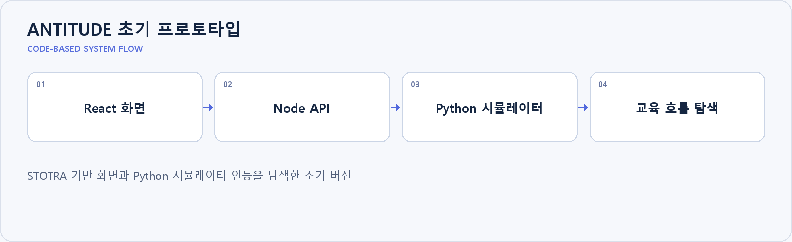

# ANTITUDE 초기 프로토타입

**STOTRA 기반 화면과 Python 시뮬레이터 연동을 탐색한 초기 버전**

## 프로젝트와 담당 범위

기존 STOTRA 프로젝트를 바탕으로 투자 교육 화면과 시나리오·시뮬레이터 연동을 탐색했습니다. 현재 ANTITUDE로 이어진 초기 버전이며 독립 프로젝트 성과로 중복 계산하지 않습니다. 이 저장소의 목표·계획과 현재 ANTITUDE의 RAG·Agent 구현 범위는 구분합니다.

## 구현 근거

[현재 ANTITUDE](https://github.com/a77315829-byte/Capstone-ver0.1)

기존 설치·구현 문서는 [README_DETAILS.md](README_DETAILS.md)에 보존했습니다.
